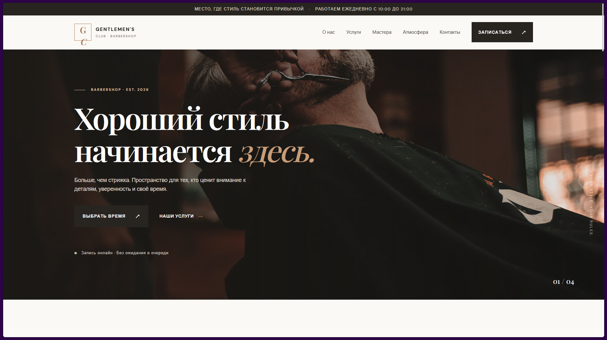
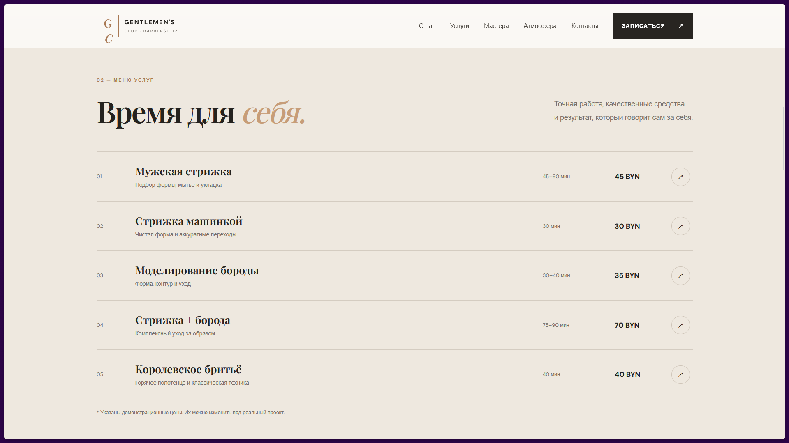
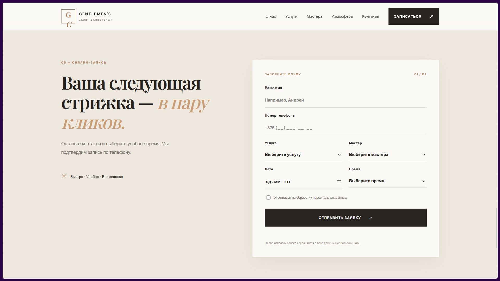
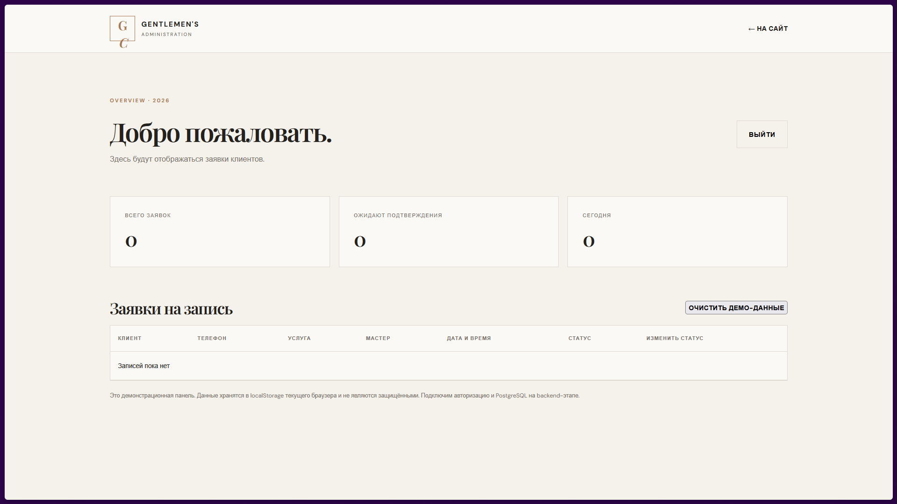
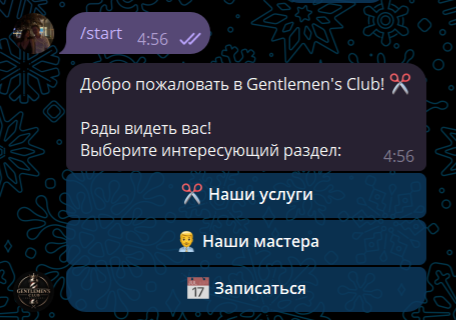

# Gentlemen's Club

### Modern Barbershop Booking Platform

A full-stack web application designed for a modern barbershop. The platform allows clients to explore services, choose a master, and book appointments online. It also includes an administration dashboard and a Telegram bot for convenient client interaction.

## About the Project

**Gentlemen's Club** is a barbershop management and booking platform created to simplify the interaction between clients and barbershop staff.

The project combines a responsive website, appointment management system, administrative dashboard, and Telegram bot into one application.

## Features

- **Online Booking** — clients can choose a service, master, date, and available time slot.
- **Services Catalog** — information about available services, prices, and durations.
- **Masters Catalog** — profiles of barbers available for appointments.
- **Admin Dashboard** — management of appointments and booking statuses.
- **Telegram Bot** — an additional interface for clients to interact with the barbershop.
- **Database Integration** — centralized storage of clients, services, masters, and appointments.
- **Authentication** — protected access to the administration panel.

## Screenshots

### Website

*Main page of Gentlemen's Club.*

*Barbershop services and pricing.*

*Online appointment booking interface.*

### Administration

*Appointment management dashboard.*

### Telegram Bot

*Telegram bot interface.*

## Technology Stack

| Technology | Purpose |
|---|---|
| HTML, CSS, JavaScript | Frontend |
| Node.js | Backend runtime |
| Express.js | REST API |
| PostgreSQL | Database |
| Prisma ORM | Database access and migrations |
| Python | Telegram bot |
| aiogram 3 | Telegram Bot API framework |
| Docker | Containerization |

## Architecture

The application consists of several interconnected components:

- **Frontend** — user-facing website and administration interface.
- **Backend** — REST API responsible for business logic, authentication, and data processing.
- **Database** — PostgreSQL database shared by the backend and Telegram bot.
- **Telegram Bot** — provides an additional way to interact with the booking system.
- **Docker** — allows the application components to run in separate containers.

See [Architecture Documentation](docs/architecture.md) for more details.

## Project Structure

The original application is maintained in a private repository. This public repository serves as a portfolio presentation and contains documentation and selected screenshots.

## Live Demo

- Website: [Coming soon]
- Telegram Bot: [Coming soon]

## Project Status

The core application functionality has been implemented. Further improvements and deployment preparation are planned.

## Author

Developed as a personal portfolio project.

---

**Gentlemen's Club — Style. Precision. Confidence.**
